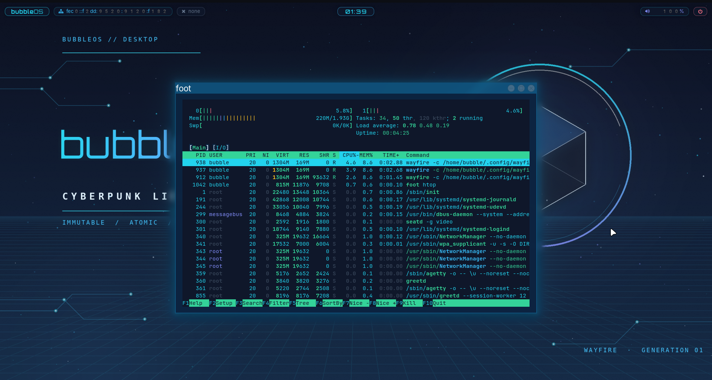

# BubbleOS

<div align="center">
  
  <h3>An experimental Linux operating system built around Btrfs generations, a custom boot flow and the ULPM / LPK package ecosystem.</h3>
  <p><strong>EXPERIMENTAL · ACTIVE DEVELOPMENT · NOT FOR PRODUCTION USE</strong></p>
  <p><a href="https://github.com/Ruraam/Bubbleos">Repository</a> · <a href="https://github.com/Ruraam/Bubbleos/issues">Issues</a> · <a href="https://github.com/Ruraam/ulpm">ULPM</a></p>
</div>

<div align="center">
  
  <sub>Bubble desktop development preview. The integrated BubbleWM desktop is still in development.</sub>
</div>

---

## What is BubbleOS?

BubbleOS is an independent Linux operating system project. It combines a Linux kernel and a conventional Unix filesystem layout with a Btrfs-based system-generation model, a custom early-boot environment, and the ULPM / LPK package ecosystem.

Development is happening in stages. The current priorities are a reliable boot path, safe system-generation management, recovery behavior and repeatable QEMU testing. The integrated desktop experience is a separate work in progress.

**Important:** BubbleOS is not yet a finished immutable distribution. The current generation layout and rollback mechanisms are implemented, but the active root generation is currently mounted writable. Read-only root enforcement and package-driven generation composition remain future work.

## Project goals

- Build a bootable, maintainable Linux operating system.
- Use Btrfs subvolumes for system generations and restore points.
- Provide predictable generation selection and boot fallback.
- Keep persistent user and system state separate from system generations.
- Use ULPM as the package engine and LPK as its package format.
- Support sandboxed application execution through Bubblewrap where applicable.
- Develop BubbleWM into an integrated Wayland desktop and system interface.
- Keep the base system understandable, testable and resource-conscious.

## Current status

The table describes the current development implementation, not a production release.

| Area | Current state |
| --- | --- |
| UEFI boot | Implemented and exercised in QEMU with Limine |
| Linux kernel | Local kernel import supported; documented development image uses Linux 7.3.1 |
| Early userspace | BusyBox initramfs with Btrfs/storage support and optional early microcode |
| Root filesystem | Btrfs image with separate subvolumes |
| System generations | Create, activate, list and rollback workflows implemented |
| Boot fallback | Initramfs tries the requested generation and configured fallback candidates |
| Restore points | Read-only Btrfs snapshots for initial state and /var |
| Boot menu | Limine configuration can be regenerated from available generations |
| Init system | systemd as PID 1 |
| Package layer | ULPM installed in the development image; APT removed from the target RootFS |
| LPK lifecycle | Pack, inspect, install, run and remove exercised by QEMU integration tests |
| Atomic package updates | Not integrated into system-generation composition yet |
| Immutable root | Not yet enforced; the current root generation is writable |
| Desktop | Bubble desktop / BubbleWM development is ongoing; not yet the complete default desktop |
| Hardware support | Kernel modules and optional firmware/userspace payloads are included by the build workflow |

### Status and measurement notes

- The approximately **300 MiB at boot** figure refers to a lightweight desktop session being explored on an Arch-based development setup. It is not a measured BubbleOS installed-image benchmark.
- The current development image is designed for serial-console testing in QEMU. It is not yet a polished installer or end-user live image.
- SELinux support is compiled into the documented kernel build, but the image does not ship a policy and currently boots with `selinux=0`. SELinux enforcement is therefore not active.
- The bootstrap process uses Debian `debootstrap` to assemble the initial RootFS. This is a build-time dependency, not the intended package interface of the installed target system.

## System architecture

### Boot flow

The current UEFI development boot path:

```text
UEFI firmware
    |
    v
EFI System Partition
    |
    v
Limine
    |
    v
Linux kernel
    |
    v
BusyBox initramfs
    |  - early userspace
    |  - storage modules as needed
    |  - locate Btrfs RootFS by UUID
    |  - select a system generation
    v
Btrfs generation mounted as /
    |
    v
switch_root
    |
    v
systemd (PID 1)
    |
    v
bubbleOS boot integration
```

The initramfs selects a generation using the explicit Limine rootflags entry when provided. If that candidate cannot be mounted, it tries the configured current, previous and newest-generation fallback candidates.

### Btrfs layout

The development image creates a Btrfs filesystem with compression and checksums. Its subvolume layout:

```text
Btrfs filesystem
├── @rootfs
│   ├── generations/
│   │   ├── 000001/
│   │   └── 000002/
│   ├── current  -> generations/<selected>
│   └── previous -> generations/<previous>
├── @home
├── @var
├── @logs
└── @snapshots
    ├── rootfs/
    └── var/
```

| Subvolume | Mount point / purpose |
| --- | --- |
| @rootfs | Generation container, mounted below /var/lib/bubbleos/rootfs |
| @rootfs/generations/<id> | Selected system root mounted as / |
| @home | Persistent /home |
| @var | Persistent /var |
| @logs | Persistent /var/log |
| @snapshots | Btrfs restore-point storage, mounted at /snapshots |

The active generation is currently writable. The layout provides generation separation and rollback capability, but it is not yet a fully immutable-root implementation.

### Generation management

The bubble command provides the current generation-management interface:

```bash
bubble status
bubble generations

# Create a generation from the active one
bubble generation create --description "test generation"

# Select a generation for the next boot
bubble generation activate 000002

# Select the previous generation
bubble rollback

# Regenerate the Limine menu
bubble bootloader sync
```

Generation activation updates the selected generation and boot menu. The new generation is used on the next boot; activation is not an in-place live root switch.

Each generation stores the kernel and initramfs assets it was built with. Bootloader synchronization maintains shared ESP assets and generation-specific copies when needed.

### Snapshots and restore

The current snapshot workflow includes read-only Btrfs restore points and a scheduled /var restore:

```bash
bubble snapshots
bubble snapshots restore var/<snapshot-name>
bubble snapshots prune --keep 10
```

A scheduled restore is performed during the next boot by bubbleos-var-restore.service. The workflow creates a safety snapshot of the replaced /var subvolume before completing the restore. Automatic pruning is configurable with BUBBLEOS_SNAPSHOT_KEEP (default: 10); initial restore points are retained.

## Package management: ULPM and LPK

The installed development RootFS does not include APT. The intended package interface is [ULPM](https://github.com/Ruraam/ulpm), with [LPK](https://github.com/Ruraam/ulpm/blob/main/docs/lpk-format.md) as its package format.

The current QEMU test suite exercises this application-package lifecycle:

```bash
ulpm --version
ulpm doctor

ulpm pack ./hello hello hello_amd64.lpk 1.0.0
ulpm inspect hello_amd64.lpk
ulpm install hello_amd64.lpk
ulpm run hello
ulpm remove hello
```

LPK packages use a SquashFS payload and an Ed25519 signature trailer. ULPM can run applications through Bubblewrap and has an extraction fallback for environments where FUSE is unavailable.

**Current limitation:** ULPM application installation is tested, but package changes are not yet composed into new BubbleOS system generations. Atomic OS updates through ULPM are a development goal, not a completed feature.

## Bubble desktop and BubbleWM

BubbleOS is intended to grow beyond a command-line development image. The longer-term desktop direction is an integrated Wayland environment built around [BubbleWM](https://github.com/Ruraam/BubbleWM).

The aim is to bring window management, compositing, session handling, panel/status UI and theme management into a coherent desktop rather than relying permanently on a collection of separate components.

This work is ongoing. The current preview is a development snapshot, not a claim that the complete BubbleWM desktop is already shipped as the default session.

## Build the development image

The following commands describe the current development workflow. Run them on a supported Linux build host with the required tools installed.

### Build dependencies

The bootstrap documentation lists tools including:

- debootstrap
- busybox-static
- cpio, gzip, xz-utils and zstd
- kmod
- btrfs-progs
- dosfstools, mtools and fdisk
- ovmf
- qemu-system-x86

Package names may differ between build-host distributions. QEMU integration tests additionally require python3-pexpect.

### Build steps

From the repository root:

```bash
# 1. Prepare/import the kernel and its matching modules
./build/build-kernel.sh

# 2. Build the BusyBox initramfs
./build/build-initramfs.sh

# 3. Bootstrap the target RootFS
sudo ./build/bootstrap.sh

# 4. Create the Btrfs RootFS image
sudo ./build/build-image.sh

# 5. Assemble the GPT disk image with an EFI System Partition
./build/build-disk-image.sh

# 6. Boot the UEFI image in QEMU
sudo DISK_IMAGE=out/bubbleos.img ./build/run-qemu.sh
```

Build artifacts are written under out/. Review the build scripts and their environment-variable overrides before changing image sizes, UUIDs, kernel inputs or output paths.

### Kernel input

The preferred path imports a locally built BubbleOS kernel when the expected kernel image and matching module tree are present:

- boot/vmlinuz-bubbleos
- ../bubble-modules/lib/modules/<kernel-release>/

A Debian package-based kernel acquisition path is also available as a bootstrap fallback:

```bash
KERNEL_SOURCE=debian ./build/build-kernel.sh
```

That fallback uses APT on the build host to download and extract kernel packages. It does not add APT back into the target RootFS.

### Firmware and hardware userspace

The bootstrap can merge firmware payloads from the configured firmware drop. It can also merge selected hardware userspace payloads without replacing files already supplied by the base RootFS packages.

Relevant overrides documented in docs/BOOTSTRAP.md include:

- FIRMWARE_DIR
- HARDWARE_USERSPACE=0
- MICROCODE=0

See [docs/BOOTSTRAP.md](docs/BOOTSTRAP.md) for the detailed build process, disk layout, kernel handling and configuration options.

## Run and debug with QEMU

### UEFI disk-image boot

```bash
sudo DISK_IMAGE=out/bubbleos.img ./build/run-qemu.sh
```

The QEMU launcher uses OVMF/UEFI for a full disk-image boot. Its default development VM configuration is 2 GiB of RAM and 2 virtual CPUs; override these with MEMORY and CPUS.

### Direct-kernel boot

For debugging without the full UEFI disk image:

```bash
sudo ROOT_IMAGE=out/bubbleos-root.img ./build/run-qemu.sh
```

To request a particular generation:

```bash
sudo ROOT_IMAGE=out/bubbleos-root.img \
  APPEND_EXTRA='rootflags=subvol=@rootfs/generations/000001' \
  ./build/run-qemu.sh
```

### Development credentials

The current development image uses:

- Username: root
- Password: bubble

Set ROOT_PASSWORD when running build/bootstrap.sh to override the development password. **Change or remove these credentials before any use outside an isolated development VM.**

Quit the QEMU serial session with Ctrl-A, then X.

## Tests

The QEMU integration suite boots a copy of the generated disk image and drives the serial console. Test suites operate on temporary copies so the original image under out/ is not modified.

```bash
./tests/qemu/run.sh                 # all suites
./tests/qemu/run.sh boot            # boot and base system checks
./tests/qemu/run.sh generations     # generation create/activate/rollback
./tests/qemu/run.sh fallback        # missing-generation fallback
./tests/qemu/run.sh snapshots       # /var restore and snapshot pruning
./tests/qemu/run.sh ulpm            # ULPM diagnostics and LPK lifecycle
```

Requirements:

- A built out/bubbleos.img
- qemu-system-x86_64 and OVMF
- python3-pexpect
- Passwordless sudo, or execution as root, for image and loop-device operations

See [tests/qemu/README.md](tests/qemu/README.md) for suite coverage, logs and environment variables.

## Repository structure

```text
.
├── boot/          Limine configuration and kernel-related inputs
├── bubble/        BubbleOS CLI and system-management libraries
├── build/         Kernel, initramfs, RootFS and disk-image build scripts
├── config/        Build and RootFS identity configuration
├── docs/          Architecture and bootstrap documentation
├── initramfs/     Early userspace init script
├── packages/      BubbleOS package definitions and related build inputs
├── tests/qemu/    QEMU boot and integration tests
└── ulpm/          ULPM source/runtime maintained alongside BubbleOS
```

Generated files and build outputs are created under out/ and are not part of the source architecture.

## Roadmap

The project is developed incrementally. Broad priorities include:

- [ ] Make boot and recovery paths robust across supported hardware and storage configurations.
- [ ] Define and enforce the read-only/immutable root-generation model.
- [ ] Integrate ULPM package transactions with system-generation creation and activation.
- [ ] Validate safe update, interruption recovery and rollback behavior.
- [ ] Continue developing BubbleWM and the integrated desktop/session experience.
- [ ] Improve hardware detection, firmware handling and installation workflows.
- [ ] Publish reproducible build instructions and measured performance results.
- [ ] Prepare an installer and a clearly versioned experimental image when the base system is ready.

## Related projects

- [BubbleWM](https://github.com/Ruraam/BubbleWM) — Wayland compositor/window-management project intended to become the foundation of the BubbleOS desktop.
- [ULPM](https://github.com/Ruraam/ulpm) — Universal Linux Package Manager and LPK package format.
- [Debup](https://github.com/Ruraam/debup) — Hybrid package discovery and management tool for Debian packages and GitHub Releases.
- [URAAM](https://github.com/Ruraam/Uraam) — Android ADB application-management and debloating toolkit.

## Contributing and feedback

BubbleOS is experimental and active development may involve breaking changes. Bug reports, reproducible test cases and focused technical discussion are welcome through [GitHub Issues](https://github.com/Ruraam/Bubbleos/issues).

When reporting a problem, include:

- The commit or branch tested.
- Build-host distribution and architecture.
- Whether the failure occurred during build, UEFI boot, generation switching or runtime.
- Relevant QEMU serial output and files from out/test-logs/.
- The exact command and environment-variable overrides used.

Please do not treat the current development image as production-ready.

## License

See the repository's license files and the individual component/package licenses. Components bundled from other projects retain their respective licenses.
