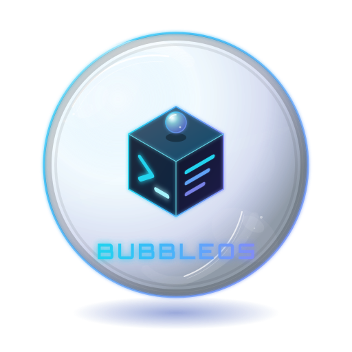

<div align="center">

<h1>BubbleOS is an experimental Linux operating system built around the Linux kernel and the ULPM/LPK ecosystem.</h1>
</div>

## Project principles

- Linux kernel
- [ULPM](https://github.com/Ruraam/ulpm) as the package engine
- [LPK](https://github.com/Ruraam/ulpm/blob/main/docs/lpk-format.md) as the native package format
- System generations and rollback
- Immutable system composition where practical
- Rootless/sandboxed applications where supported by ULPM
- No APT, DNF, RPM or Pacman in the final installed operating system

## Repository layout

- `ulpm/` — BubbleOS-maintained copy of ULPM
- `bubble/` — BubbleOS system core and CLI
- `build/` — bootstrap and image build tooling
- `boot/` — boot integration
- `initramfs/` — early userspace
- `config/` — system and image configuration (including the RootFS UUID)
- `packages/` — BubbleOS package definitions
- `docs/` — architecture and development documentation

## Current status

The current image provides a **bootable UEFI system with systemd**:

- Linux **7.3.1**, built locally and imported from `boot/vmlinuz-bubbleos` with
  the matching `bubble-modules/` tree;
- BusyBox initramfs with the Btrfs storage modules needed to mount the RootFS
  and an early microcode archive for Intel and AMD CPUs;
- complete kernel module tree installed in the RootFS (`/lib/modules/7.3.1`,
  260 modules) with `depmod` indexes, so loadable graphics, audio, Bluetooth
  and other drivers are available;
- firmware merged from the local `firmware/` drop (AMD/Intel graphics, Intel
  Wi-Fi, MediaTek, Realtek, Cirrus, SOF and both CPU microcode packages), plus
  the matching DRM/VA-API, libwacom, Thunderbolt and USB Type-C userspace
  payloads;
- GPT disk with a FAT32 EFI System Partition and a **Btrfs** RootFS, compressed
  with **zstd level 1** and protected by data checksums;
- Limine 12.9.6 as the UEFI bootloader;
- systemd 257 as PID 1, serial console login and `bubbleos-boot.service`;
- real generation subvolumes: `@rootfs/generations/000001`,
  `@rootfs/current -> generations/000001`, plus `@home`, `@var`, `@logs` and
  `@snapshots`;
- stable RootFS identification by filesystem UUID (`root=UUID=...`) instead of
  a kernel device name, with a fixed GPT partition UUID;
- read-only restoration snapshots of the initial generation and of `/var`,
  with a `/var` restore workflow and automatic pruning;
- a Limine menu regenerated from the live generation list, with one explicit
  `rootflags=subvol=...` entry per generation, and an initramfs fallback chain
  (`rootflags` → `current` → `previous` → newest generation);
- bubbleOS console branding, package documentation and bug metadata removed,
  and **no APT** in the target: ULPM/LPK is the package layer;
- ULPM 6.0.0 installed in `/opt/bubbleos/ulpm` with its runtime toolchain
  (`bubblewrap`, `squashfs-tools`, `squashfuse`, `fuse-overlayfs`, `jq`,
  `curl`, `openssl`, `xdg-dbus-proxy`), validated in QEMU for LPK
  pack/inspect/install/run/remove workflows;
- SELinux is built into the kernel but disabled at boot (`selinux=0`) because
  no policy is shipped; enabling it later requires a policy package.

`bubble generation create` clones the active generation into the next Btrfs
subvolume. `bubble generation activate` snapshots the outgoing generation and
`/var`, then switches `@rootfs/current`; the new generation is used on the next
boot. `bubble rollback` selects the previous generation. `bubble bootloader
sync` rewrites `/boot/limine.conf` on the ESP so every generation has its own
menu entry; `create`, `activate` and `rollback` call it automatically. Each
generation carries the kernel and initramfs it was built with in
`/usr/lib/bubbleos/boot`. The shared ESP pair (`/boot/vmlinuz` and
`/boot/initramfs.cpio.gz`) follows the current generation; generations whose
assets differ get private copies under `/boot/generations/<gen>/`, and stale
copies are pruned on every sync. If the selected subvolume is missing or fails
to mount, the initramfs falls back to `current`, then `previous`, then the
newest generation instead of dropping to a rescue shell.

`bubble snapshots restore <name>` schedules a `/var` restore for the next boot;
`bubbleos-var-restore.service` performs the swap before `/var` is mounted and
keeps a read-only `pre-restore` safety snapshot of the replaced subvolume.
`bubble snapshots prune` removes old automatic snapshots while always keeping
the `*-initial` restore points; activation prunes automatically with
`BUBBLEOS_SNAPSHOT_KEEP` (default: 10). Package-driven generation composition
is not integrated yet.

## Package management

The target boots without APT. ULPM provides the application-level package
workflow:

```bash
ulpm --version
ulpm doctor
ulpm pack ./hello hello hello_amd64.lpk 1.0.0
ulpm inspect hello_amd64.lpk
ulpm install hello_amd64.lpk
ulpm run hello
ulpm remove hello
```

LPKs are SquashFS images with an Ed25519 signature trailer. Applications run
in a Bubblewrap sandbox and fall back to temporary extraction when FUSE is not
available. Generation composition through ULPM is still on the roadmap.

## Quick start

```bash
./build/build-kernel.sh          # local 7.3.1 kernel + modules -> out/kernel/
./build/build-initramfs.sh       # initramfs + early microcode -> out/initramfs.cpio.gz

sudo ./build/bootstrap.sh         # base RootFS + systemd + modules + firmware
sudo ./build/build-image.sh       # Btrfs RootFS -> out/bubbleos-root.img
./build/build-disk-image.sh       # GPT + ESP + RootFS -> out/bubbleos.img

sudo DISK_IMAGE=out/bubbleos.img ./build/run-qemu.sh
```

`build/build-kernel.sh` imports the local kernel automatically when
`boot/vmlinuz-bubbleos` and `../bubble-modules/` are present. A Debian package
fallback remains available for a host without those files:

```bash
KERNEL_SOURCE=debian ./build/build-kernel.sh
```

`build/bootstrap.sh` merges every `firmware/*/usr/lib/firmware` payload into
`/usr/lib/firmware`. It also installs the hardware userspace payloads from the
same drop (`bolt`, `libdrm-*`, `libwacom`, `libtypec0`, `libusb3380`,
`intel-media-va-driver`) without replacing files already provided by the base
packages. Disable that part with `HARDWARE_USERSPACE=0`.

The UEFI boot chain reaches a systemd login prompt:

```text
UEFI -> ESP (Limine) -> Linux 7.3.1 -> initramfs (microcode + Btrfs)
     -> Btrfs UUID -> @rootfs/current (fallback: previous/newest)
     -> generation subvolume -> switch_root -> systemd
     -> bubbleos-boot.service
```

Generations and snapshots:

```bash
bubble status
bubble generations
bubble generation create --description "test generation"
bubble generation activate 000002   # reboot required
bubble rollback                     # reboot required
bubble bootloader sync              # rewrite the Limine menu
bubble snapshots
bubble snapshots restore var/<name> # /var restored at the next boot
bubble snapshots prune --keep 10    # keep the newest 10 automatic snapshots
```

Development login: **root / `bubble`** (override with `ROOT_PASSWORD=...` when
running `build/bootstrap.sh`). Quit QEMU with `Ctrl-A`, then `X`.

For a direct-kernel boot without UEFI firmware:

```bash
sudo ROOT_IMAGE=out/bubbleos-root.img ./build/run-qemu.sh

# Boot an explicit generation (missing ones fall back to current/previous)
sudo ROOT_IMAGE=out/bubbleos-root.img \
    APPEND_EXTRA='rootflags=subvol=@rootfs/generations/000001' \
    ./build/run-qemu.sh
```

See `docs/BOOTSTRAP.md` for details and overrides.

## Tests

The QEMU integration suite boots the image and drives the serial console:

```bash
./tests/qemu/run.sh                 # all suites
./tests/qemu/run.sh boot            # kernel, Btrfs, /boot, systemd, packages
./tests/qemu/run.sh generations     # create/activate/rollback + Limine entries
./tests/qemu/run.sh fallback        # broken current + missing subvolume
./tests/qemu/run.sh snapshots       # /var restore + pruning
./tests/qemu/run.sh ulpm            # diagnostics + LPK pack/install/run
```

It requires `python3-pexpect`, QEMU/OVMF and passwordless `sudo`. Each suite
works on a temporary copy of `out/bubbleos.img`; see `tests/qemu/README.md`.

---

## 🛠️ Related Projects

* [**Universal Ruvomain ADB App Manager [URAAM]**](https://github.com/Ruraam/Uraam)  [](https://github.com/Ruraam/Uraam/stargazers) — An all-in-one shell toolkit for `Android debloating`. Uninstall/disable your apps, backup your debloat apps JSON file& revert/restore, install apk. Works with `Termux WirelessADB, Shizuku, Root`, `LinuxDebian, Arch, Fedora, macOS & WSL`. Compatible with Canta/UAD JSON lists.

* [**Debup**](https://github.com/Ruraam/debup)  [](https://github.com/Ruraam/debup/stargazers) - Search, discover, track, install, and upgrade .deb packages directly from APT & GitHub Releases simultaneously

*  [**Universal Linux Package Manager [ULPM]**](https://github.com/Ruraam/ulpm)  [](https://github.com/Ruraam/ulpm/stargazers) —Lightweight, rootless, zero-daemon, sandboxed `application/read-only OS runtime` for any Linux distribution. Lighter thanFlatpak or Snap.
